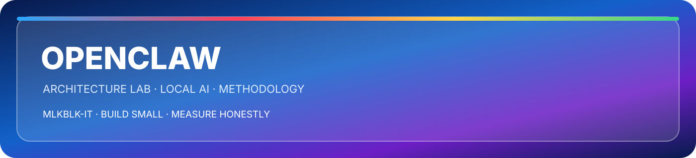

> ⚠️ **Note:** The rest of this repository (code, comments, scripts, docs, commits, issues) is written in **French**. Only this README is in English.

<div align="center">

<p align="center"></p>

   

</div>

> **This repository is a LAB.** It documents an architecture methodology and
> what a full reset costs. It is **not** a server, **not** an MCP server and
> **not** a product you install. There is nothing to run here.

## At a glance

| | |
|---|---|
| **What it is** | A **lab** — an architecture methodology, and what a full reset costs. |
| **What it is not** | Not a server, not an MCP server, not a product you install. **There is nothing to run here.** |
| **Focus** | LM Studio · local models · agentic AI · methodology + docs |

## What it is

A **research lab** on hybrid local (LM Studio) + cloud AI architectures. The
subject is the architecture itself: how it is specified, how it is hardened, and
what happens when it is built without contracts.

Two complete iterations are documented:

- **V1 — the accumulation**: a 7-layer hybrid stack, 14 troubleshooting reports,
  15 stacked fallbacks, and a "works on my machine" sequence that became
  unmaintainable.
- **V2 — the reset**: clean slate, machine contracts written before code, strict
  MAIN (system) / LOCAL (LM Studio) separation, a 10-phase runbook and a
  hardening pass.

## Quickstart

There is nothing to install. Read it in this order:

1. [`Rapport_Consolide_OpenClaw.md`](Rapport_Consolide_OpenClaw.md) — the consolidated report (French).
2. [`V2/OpenClaw_AI_Machine_Language_Architecture_Contract.md`](V2/OpenClaw_AI_Machine_Language_Architecture_Contract.md) — the machine contract written before any code.
3. [`V2/OpenClaw_Hardening_Structurel.md`](V2/OpenClaw_Hardening_Structurel.md) — the structural hardening.
4. [`V2/OpenClaw_Reset_V2_Professional_Action_Plan.md`](V2/OpenClaw_Reset_V2_Professional_Action_Plan.md) — the runbook.

## Structure

```
├── V1/
│   └── Document Project/     # 14 reports (architecture, deployment, diagnostics)
├── V2/
│   ├── OpenClaw_AI_Machine_Language_Architecture_Contract.md
│   ├── OpenClaw_Reset_V2_Professional_Action_Plan.md
│   ├── OpenClaw_Hardening_Structurel.md
│   └── OpenClaw_V2_Session1_Journal_et_Plan.md
└── Rapport_Consolide_OpenClaw.md
```

## What this lab demonstrates

1. **Technical-debt awareness** — identifying and recording the failure rather than patching forever
2. **Methodology** — contracts before code, separation of concerns
3. **Rigorous documentation** — every decision traced, every failure analyzed

## Status

| Item | State |
|---|---|
| Nature | **LAB / research documentation** — no runnable product, no server |
| V1 | Closed — the technical debt is documented and kept as reference |
| V2 | Contract + hardening + runbook written; the implementation is a separate, later effort |
| MCP | **Not applicable** — this repository contains no MCP server |
| Language | French for the content, English for this README |

## Author

Malik — IT Support student (DEP), self-taught
Project: August 2026


## Ownership and license

[Project origin and evidence](PROJECT-ORIGIN.md) · [License](LICENSE)

---

<div align="center">


**⚡ Built on CPU. Proven on disk. ⚡**

</div>


---

<div align="center">

<sub>Original project and documentation by <strong>Malik Belkacemi · MLKBLK-IT</strong> · © 2026</sub>

</div>
